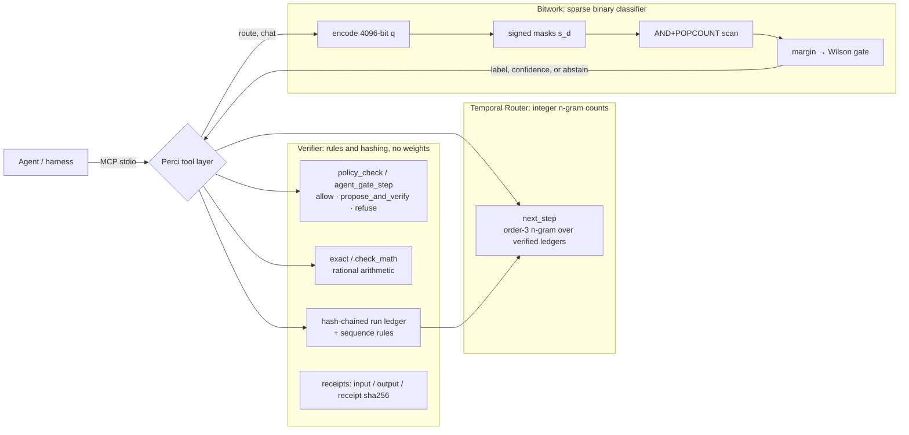

# Bitwork: Deterministic Sparse Binary Routing for Local AI Agent Tooling

**James Paul Jackson**
Perci project · White paper v1.0 · October 18, 2026
Code: [github.com/jacksonjp0311-gif/Perci](https://github.com/jacksonjp0311-gif/Perci) at Perci 0.11.8 · Packs: `PERCIW02` v0.2, `PERCIW03` v0.3 · Evaluation: [`evals/bitwork_baseline/`](../evals/bitwork_baseline/)

---

## Abstract

Bitwork is the integer bit-vector classifier inside Perci, a local verification tool for AI agents. It routes a short request to one of 16 categories. The label decision uses no neural network and no floating-point arithmetic. Each prompt is hashed into a sparse 4,096-bit vector: about 70 lexical and structural features, each setting up to four bits taken from one 64-bit FNV-1a hash. The vector is scored against signed per-category bit masks, and then against up to 403,163 stored prototype vectors with `AND` and `POPCOUNT`. We show that the prototype score in the code, $2\lvert q \wedge p\rvert - \lvert p\rvert$, is exactly $\lvert q\rvert - H(q,p)$, so retrieval is Hamming-nearest-neighbour search, offset by a domain score. The output is a label, a score margin, and a confidence read from a calibration table measured per margin bucket, reported as a Wilson 95% lower bound. The router abstains when that bound is below a gate. Packs are checksummed and pinned, and promoting a new pack requires a recorded human authorization.

We evaluate on the 158 held-out cases that Perci's calibration uses, and compare against baselines trained on Bitwork's own 450,526-prompt training corpus, regenerated byte-for-byte. The shipped 200 MiB pack labels 84.2% (133/158) correctly, against 66.5% for TF-IDF + logistic regression, 59.5% for TF-IDF nearest-neighbour, 50.6% for BM25 nearest-neighbour and 53.2% for a keyword router. Two results temper that number. With its hand-written keyword priors switched off, the same pack scores 55.1%, below TF-IDF + logistic regression. And the prior table overlaps the held-out phrasing: 33 multi-word cues appear in held-out prompts but nowhere in the training corpus. So the 84.2% is not a clean held-out result for the full system. What Bitwork does offer is easy to verify: labels are byte-identical across processes, every score can be inspected, and a route call costs 0.41 ms (20 MB pack) or 3.3 ms (200 MiB pack) p50 on an 8-vCPU machine. We also state precisely where Bitwork sits in Perci. It labels requests for the `route` tool and the experimental chat engine. Perci's verifier (`allow` / `propose_and_verify` / `refuse`, receipts, hash-chained ledger) and its Temporal Router (`next_step`) use rules, hashing and integer n-gram counts, not Bitwork.

---

## 1 Introduction

Agent harnesses keep asking small classification questions: is this request arithmetic, a memory lookup, a code question, or something a language model should handle? A second model call answers that slowly, costs tokens, needs a network, and can give different answers to the same input. Perci is a local MCP server and CLI that checks what agents do: it recomputes math, gates shell steps against a readable policy, and keeps a hash-chained ledger. For the routing question it uses Bitwork, a small classifier designed around four properties:

1. **Deterministic.** The same input and pack give the same label, byte for byte, in any process. Section 10.4 measures this.
2. **Inspectable.** Every quantity in the decision is an integer count of bits: overlaps, mask hits, prior points, margins. A wrong label can be traced to the bits that caused it.
3. **Local.** The pack is a memory-mapped file read with integer operations. No accelerator, network or model runtime is needed.
4. **Small and fast.** The default tool pack is 20 MB, and a route call takes well under a millisecond (Section 10.3).

The trade-off is clear. Bitwork is not a language model. It does not generate text, and its accuracy depends on how well its synthetic training curriculum covers the user's phrasing. This paper describes the method exactly as implemented, measures it against standard baselines on the same data, and reports where it falls short.

**Contributions.**
- A complete, code-referenced specification of Bitwork's encoding, scoring, retrieval and calibration (Sections 3 to 8), including the identity that turns its prototype score into Hamming-nearest-neighbour search (Section 5.1).
- A reproducible baseline comparison on Perci's held-out routing cases, with baselines trained on the exact regenerated training corpus, an ablation of the keyword priors, and a check for prior/held-out overlap (Section 10).
- A plain account of the limits: weak compositional binding, priors doing much of the work, small self-written test sets (Sections 6 and 11).
- An explicit boundary between Bitwork and the rest of Perci (Section 9).

## 2 Background and related work

Bitwork combines well-known ideas. The value it adds is in how they are assembled, and in the receipts, integrity checks and calibration around them, not in any single primitive.

**Feature hashing.** Weinberger et al. [1] showed that hashing sparse features into a fixed-size vector preserves inner products with high probability and makes vocabulary-free models practical. Bitwork's encoder is a binary, multi-position variant: each feature string is hashed with FNV-1a [2], and four positions are set instead of one signed count.

**Bloom filters.** Bloom [3] introduced setting $k$ hashed bits per element in a bit array, accepting false positives in exchange for space. A Bitwork query vector is literally a Bloom-style set of its features, with $k \le 4$ positions per feature. The overlap between two such vectors estimates how many features they share, plus a chance term (Section 3.3).

**Associative memory.** Willshaw, Buneman and Longuet-Higgins [4] stored binary associations in a clipped Hebbian matrix and retrieved them by thresholded overlap. Kanerva's sparse distributed memory [5] addresses stored patterns by Hamming distance in high-dimensional binary space. Bitwork stores its prototypes explicitly and searches them exhaustively within the selected categories. It does not superimpose them in a matrix, so it is closer to nearest-neighbour search than to a Willshaw or SDM memory. The code's comments call the concept-selection step "Willshaw-lite" (Section 5.4). It is a simple overlap with per-concept binary vectors, inspired by that work rather than an implementation of it.

**Hyperdimensional computing and vector-symbolic architectures.** Kanerva's binary spatter codes [6] and his tutorial on hyperdimensional computing [7] describe binding by XOR, bundling by majority and sequencing by permutation, over dense random binary vectors (about half the bits set). Plate's holographic reduced representations [8] do the same with circular convolution over real vectors. Bitwork borrows these operators but applies them to very sparse vectors (8 of 4,096 bits). Section 6 shows this matters: XOR binding of sparse codes is nearly a union, and majority bundling of near-disjoint codes is nearly empty. Rachkovskij and Kussul's context-dependent thinning [9] is the established binding operation for sparse binary codes, and we list it as future work.

**Binary codes and Hamming retrieval.** Comparing binary codes by Hamming distance goes back to Hamming [10]. Locality-sensitive binary sketches [11] and learned semantic hashing [12] make retrieval in Hamming space fast. Bitwork's codes are not learned and not locality-sensitive by design. Similarity comes only from shared hashed features.

**Baselines and calibration.** We compare against TF-IDF with logistic regression and nearest-neighbour search (scikit-learn [13]), and Okapi BM25 [14]. Calibration uses Wilson's score interval [15]. The general point that a classifier's raw score is not a probability is well documented for neural networks [16], and it holds just as much for integer margins (Section 7).

## 3 Representation

### 3.1 Normalization

Routing first repairs common typos and lowercases the text (`normalize_for_routing`, `src/text_normalize.rs`). The encoder then keeps ASCII letters and digits and turns every other run of characters into a single space (`normalize`, `src/cognitive.rs`). The result is a word sequence $w_1,\dots,w_n$. Non-ASCII letters are dropped, a limitation for non-English text.

### 3.2 Feature strings

The bag features match the ones the packs were built with (`encode_bag_only` in Rust, `feature_strings` in `scripts/build_weights.py`):

| family | feature string | count |
|---|---|---|
| bias | `bias` | 1 |
| length bucket | `len:` + min(n, 31) | 1 |
| word | `w:` + word | n |
| 3-char prefix and suffix (words of 3+ chars) | `p:` + first 3, `s:` + last 3 | up to 2n |
| word pair | `b:` + word + `\|` + next word | n − 1 |
| character trigram over words joined by `_` | `c:` + 3 chars | about the joined length − 2 |

At query time, `encode_with_composition_ctx` adds three more groups:

- **Structure features** (`encode_structure_features`): question-type tags (`ask:why`, `ask:how`, `ask:compare`, `ask:connect`, `ask:what`, `ask:question`), order-free content pairs (`pair:a|b`, with a and b sorted), negation scope (`neg:scope`, `neg:<next content word>`), and light role guesses (`role:agent|x`, `role:domain|x`, `role:contrast|x`, `role:topic|x`, `role:focus|x`). These come from fixed word lists and positions. There is no part-of-speech tagging.
- **A compositional overlay** (`encode_vsa_composition`, Section 6), plus one hashed `vsa:role:filler` feature per role-filler pair.
- **Session context** in chat only (`encode_session_context`): up to six recent content words, each bound under a `CTX` role.

### 3.3 Hashing into 4,096 bits

Let $D = 4096$. For a feature string $f$, let $h(f)$ be its 64-bit FNV-1a hash (offset basis `0xcbf29ce484222325`, prime `0x100000001b3`) [2]. `set_feature` sets the bits at the positions

$$
\pi_j(f) = \left\lfloor h(f) / 2^{12j} \right\rfloor \bmod 2^{12}, \qquad j = 0,1,2,3,
$$

which are the four 12-bit slices of the low 48 bits. The query vector is the bitwise OR over all features $F(x)$ of the prompt:

$$
q(x) = \bigvee_{f \in F(x)} \; \bigvee_{j=0}^{3} e_{\pi_j(f)} \;\in\; \{0,1\}^{D},
$$

where $e_i$ is the $i$-th unit bit vector. It is a random sparse map in the style of a Bloom filter, not a learned embedding: two prompts are close only when they share feature strings or happen to collide.

**Density.** If $m$ hashed positions behave like independent uniform draws, the expected weight is $D\,(1-(1-1/D)^{m})$. On the 158 held-out prompts the bag-only weight has a median of 278 bits, and the full query weight (with structure and composition features) a median of 329 bits, p95 402. Stored prototypes have a median of 403 bits, p5 to p95 318 to 475, about 10% density.

**Chance overlap.** For a query of weight $k_q$ and an unrelated prototype of weight $k_p$, the overlap follows a hypergeometric distribution with mean $k_q k_p / D$. With typical weights this is about $329 \cdot 403 / 4096 \approx 32$ bits of chance overlap that real matches must exceed. The engine reports the matching z-score as telemetry (`chance_normalized_overlap`):

$$
z = \frac{\lvert q \wedge p\rvert - k_q k_p / D}{\sqrt{k_q \frac{k_p}{D}\left(1-\frac{k_p}{D}\right)\frac{D-k_q}{D-1}}}.
$$

**Collisions.** Two different features land on all four of the same positions only if their hashes agree on the low 48 bits. But at 10% density any new feature bit has roughly a 1-in-10 chance of falling on a bit that is already set. The four positions are slices of one hash, not four independent hash functions, and we have not measured how independent they are in practice (Section 11).

## 4 Category scoring and domain selection

### 4.1 Signed category masks

Each of the 16 categories $d$ (greeting, identity, english, logic, math, geometry, memory, code, governance, planning, explanation, systems, science, creativity, comparison, general) has a positive mask $m_d^{+}$ and a negative mask $m_d^{-}$ of 512 bits each. They are built in `top_mask` (`scripts/build_weights.py`) by comparing how often each bit is set inside the category versus outside it, normalized by record counts so that large categories do not dominate:

$$
\delta_d(i) = \frac{\#\{p \in d : p_i = 1\}}{\lvert d\rvert} - \frac{\#\{p \notin d : p_i = 1\}}{N - \lvert d\rvert}.
$$

$m_d^{+}$ holds the 512 bits with the largest $\delta_d$, and $m_d^{-}$ the 512 with the smallest. This is the only learned step in a pack, apart from storing the prototypes themselves.

### 4.2 The category score (as implemented)

In `CognitiveWeights::classify_impl` (`src/cognitive.rs`) the score of category $d$ for query $q$ is

$$
s_d(q) = 2\,\lvert q \wedge m_d^{+}\rvert - \lvert q \wedge m_d^{-}\rvert + \rho_d(x),
$$

where $\lvert\cdot\rvert$ is the population count and $\rho_d$ is the keyword prior. Positive evidence counts double. Earlier notes wrote $\lvert q\wedge m^+\rvert - \lvert q\wedge m^-\rvert$; the code's factor of 2 is what runs.

**Keyword priors.** With the built-in table (`lexical_priors`), $\rho_d = 48 \cdot c_d$ for `PERCIW02` packs, where $c_d$ is the number of cue phrases for $d$ found in the padded, normalized text. For `PERCIW03` packs the prior is doubled, $\rho_d = 96\,c_d$. The table has 248 cue phrases for 15 categories. The `general` category gets 48 points per general marker, or a default 48 when no specific cue matches. These priors are large: one matched cue on the v0.3 pack is worth as much as 48 extra positive mask hits. Section 10.2 measures how much they contribute. Packs that are not built in default to no priors (`LexicalPriors::Off`) or ship their own table.

### 4.3 Which categories are scanned

Categories are sorted by $s_d$. The engine fully scans the top 5 (top 10 for prompts that look multi-domain or open-ended). It widens to at least 9 when the gap between the 1st and 3rd scores is under 10, and to at least 12 when it is under 4. Any category whose effective prior is 6 or more is always included, and the total is capped at 14. This bounds latency while keeping close decisions open.

## 5 Retrieval, mixture and the second look

### 5.1 Prototype score, and why it is Hamming nearest-neighbour search

Each record in a pack is 520 bytes: an 8-byte header (`variant`, `quality`, `popcount`, `concept_id`, each u16) followed by the 512-byte prototype vector $p$. Within a scanned category $d$, the record score (`scan_reference`, reproduced exactly by `scan_fast` and `scan_domain_light`) is

$$
S(q,p) = 2\,\lvert q \wedge p\rvert - \lvert p\rvert + 2\,s_d(q) + \left\lfloor \tfrac{\text{quality}(p)}{500} \right\rfloor .
$$

Write $H(q,p) = \lvert q\rvert + \lvert p\rvert - 2\lvert q \wedge p\rvert$ for the Hamming distance. Then

$$
2\,\lvert q \wedge p\rvert - \lvert p\rvert = \lvert q\rvert - H(q,p).
$$

Since $\lvert q\rvert$ is fixed for a given query, ranking records by the geometric part of $S$ is the same as ranking them by Hamming distance. Inside one category, Bitwork is exact Hamming nearest-neighbour search. Across categories, a record's score is shifted by $2 s_d$, so one point of category score is worth two bits of Hamming distance. In both shipped packs every record has quality between 500 and 999, so the quality term is the constant 1 and never changes a ranking. We checked all 403,163 v0.3 and 38,580 v0.2 records.

**Worked example** (`perci classify "compare rust and python for latency"`, v0.3 pack). The query has $\lvert q\rvert = 262$. The best record has $\lvert p\rvert = 132$ and overlap 58, so $H = 262 + 132 - 116 = 278$ and the geometric term is $116 - 132 = -16 = 262 - 278$. The `comparison` category has 70 positive and 33 negative mask hits and one matched cue ("compare", 96 points on a v3 pack), so $s_d = 140 - 33 + 96 = 203$. The total is $S = -16 + 406 + 1 = 391$. Another record also scores 391, so the margin is 0, and calibration puts this label in the 0-margin bucket ($L = 468$‰): `route` abstains. Every number above is printed by the tool.

**Kernel.** The overlap is 64 word-wise `AND`s plus hardware `POPCNT` when the CPU has it (`overlap_bits`). `scan_fast` skips a record whenever even a perfect overlap, $\min(\lvert q\rvert,\lvert p\rvert)$, could not beat the current k-th best. This pruning is exact. Large scans are split across up to 8 threads by category and merged in the reference order, so the result is identical to the single-threaded reference scan (`PERCI_SCAN=reference`).

### 5.2 Label and margin

Each scanned category keeps its top 3 records (top 4 for wide prompts). These are pooled and sorted by $S$. The label is the category of the best record $p^{\star}$. The **margin** is $S(q,p^{\star})$ minus the second-best score in the pool, which may come from the same category. The `route` tool returns the label, score, runner-up score, margin, concept id and the alternatives (Section 5.3).

### 5.3 Top-k mixture

For the chat engine, up to 6 further pool members become *supports*: records scoring at least half of $S(q,p^{\star})$ when the decision is contested (margin under 12, or a multi-domain prompt), otherwise at least two thirds, with duplicates removed. Each support gets an attention weight in permille, proportional to its overlap (`assign_attention_weights`). This is a proportional share of overlap mass, not softmax attention, and the code's "attention" naming is an analogy. Supports never change the label.

### 5.4 Concept selection

Each v0.3 category carries 4 to 18 short concept texts (124 in total) in the pack header. `select_concept` picks one per pool member by alias phrases and word overlap first, then by $\lvert q \wedge c\rvert$, where $c$ is the bag encoding of the concept text. The chosen concept supplies the chat engine's "insight" line. Routing does not use it.

### 5.5 The second look (residual hops)

To surface a second idea that the best match does not cover, the engine masks out the winner's bits and searches again, over the existing pool only (no new scan):

$$
q_1 = q \wedge \neg p^{\star}, \qquad q_2 = q_1 \wedge \neg p_1 .
$$

A hop runs only while at least 6 query bits remain. It scores pool records by $2\lvert q_h \wedge p\rvert - \lvert p\rvert$, adds bonuses for a different category or concept, and requires an overlap of at least 4 (`residual_hop_pool`). There are at most two hops. The code calls this a "residual stream". It is a greedy explain-away step over the pool, not a transformer residual pathway, and it only adds supports for the chat engine.

## 6 Compositional layer, and its limits

The query encoder adds a small vector-symbolic overlay (`encode_vsa_composition`). Heuristics in `extract_role_fillers` pull out up to 8 role-filler pairs (`ask`, `agent`, `domain`, `contrast`, `neg`, `topic`, `focus`, `relate`). Each symbol $s$ gets an atom $a(s)$ with 8 hashed positions (`atom_hv`, salted so it differs from the bag code). Then

$$
b_i = a(r_i) \oplus \rho^{\,17i+3}\!\left(a(f_i)\right), \qquad
c = \operatorname{maj}(b_1,\dots,b_k), \qquad q \leftarrow q \vee c,
$$

where $\rho^{t}$ rotates by $t$ bit positions (`permute_hv`), $\oplus$ is XOR (`bind_hv`), and $\operatorname{maj}$ keeps the bits set in more than half of the parts, falling back to OR for fewer than 3 parts (`bundle_hv`). One hashed `vsa:role:filler` feature (4 bits) is also set per pair.

This design was built for dense codes, and at 8 bits in 4,096 it behaves differently. We measured it on all 158 held-out prompts with a probe test calling the real functions:

- **XOR binding is essentially a union.** Two random 8-bit atoms almost never share a bit (expected shared bits $8\cdot 8/4096 \approx 0.016$), so $a \oplus b = a \vee b$. Across all bound pairs in all 158 prompts, XOR and OR differed in 13 bits in total. Binding by XOR adds no relational structure beyond listing both symbols.
- **Majority bundling keeps almost nothing.** 152 of 158 prompts had 3 or more pairs, so majority applied. In those, the bundle had 0 bits (95 prompts) or about 8 bits (57 prompts: the atom of a role repeated in most pairs, such as `relate`), and at most 1 filler bit. The overlay holds essentially none of the filler information.
- **Prototypes never see the overlay.** Packs were built from bag-only encodings, so composition bits on the query can only add mismatches or chance overlap.

In practice, the composition information that reaches the scorer comes from the plain hashed features (`vsa:*`, `role:*`, `pair:*`, `ask:*`). These lift the full query weight from a median of 278 to 329 bits. We describe the overlay honestly as a query-side annotation, not a working binding mechanism. Section 12 lists fixes.

## 7 Calibration and abstention

A raw margin is not a confidence. On the 158 held-out cases, v0.2's accuracy is not monotonic in the margin (its 4-8 bucket is worse than its 2-4 bucket), and it gets labels wrong at margins up to 24 (`max_wrong_margin` in `config/route-calibration/v0.2.json`). `perci packs calibrate` (`weight_packs::calibrate`) therefore bins cases by margin, with bucket lower edges $\{0,1,2,4,8,16,32,64\}$, and stores the count $n_b$ and number correct $c_b$ for each bucket. At run time (floating point appears only here and in telemetry such as the z-score, after the integer label is fixed) `calibrated_confidence` finds the bucket for the observed margin and reports the Wilson 95% lower bound [15] (`wilson_lower_permille`, $z = 1.96$, $\hat p = c_b/n_b$):

$$
L_b = \frac{\hat p + \dfrac{z^2}{2n_b} - z\sqrt{\dfrac{\hat p(1-\hat p)}{n_b} + \dfrac{z^2}{4n_b^2}}}{1 + \dfrac{z^2}{n_b}} .
$$

The `route` tool accepts the label when $L_b \ge \tau$ (default $\tau = 700$‰, which a profile or the call can change). Otherwise, if the deterministic route is `llm`, the verdict is `abstain` with reason `ROUTE_LOW_CONFIDENCE`, telling the caller to keep its own routing (`gate`, `src/tools/route.rs`). Small buckets are deliberately pessimistic: a bucket with 1 case out of 1 correct has $L = 206$‰. A pack without calibration reports `uncalibrated` and gates only on an explicit `min_margin`.

**What this buys and what it does not.** The v0.3 table accepts only margins 1 to 3 and 16 to 31 (buckets with $L$ = 758, 727 and 815‰) and abstains at every other margin. On the 158 cases, that accepts 86 labels, of which 78 are correct (90.7%), and abstains on 72. For v0.2 it accepts 9, all correct. But the calibration table was measured on these same 158 cases, so these selective-accuracy figures are in-sample. They show the mechanism working, not its accuracy on new data.

## 8 Weight packs, integrity and governance

**Format.** A pack starts with a fixed 80-byte header (magic `PERCIW01`/`02`/`03`, version, bit and word counts, label count, record count, header size, declared file size, corpus SHA-256), followed by the category table (name, record range, concept count, masks), the v3 concept table, and then the records. `CognitiveWeights::load` memory-maps the file and rejects it on unknown magic, a size mismatch, a header or table that runs past its bounds, non-contiguous ids or invalid UTF-8.

| pack | magic | bytes | prototypes | concepts | role |
|---|---|---:|---:|---:|---|
| v0.2 | `PERCIW02` | 20,094,368 | 38,580 | 0 | default `route` pack |
| v0.3 | `PERCIW03` | 209,710,296 | 403,163 | 124 | chat engine; `route` with `pack: "v0.3"` |

**Reproducible builds.** The v0.3 pack comes from `scripts/build_weights_v4.py`: 60,000 seeded prompt generations for each of the 16 categories (960,000 total), deduplicated by activation, then thinned evenly to fit under 200 MiB. The manifest records the SHA-256 of the generated corpus. Our evaluation regenerates it and gets the same hash (`a99b39e4…679c6c`).

**Integrity.** Built-in packs are pinned by SHA-256 in `models/PACKAGE_MANIFEST.json`. Profile packs are pinned in `profile.json`. Loading through `weight_packs::load` hashes the whole mapped file and fails with `PACK_UNAVAILABLE` on any mismatch. Perci never silently falls back to another pack. Every `route` verdict records the pack identity (`name@version manifest-sha256:…`) in its receipt.

**Governance.** Nothing promotes a pack automatically. `scripts/promote_v2.py` requires an `--authorize` statement of at least 12 characters and a matching evaluation receipt, and appends both to `models/promotion-ledger.jsonl`, chained to the previous entry's receipt hash. The learning loop can stage candidate packs but cannot activate one.

## 9 Bitwork in Perci: what it does and what it does not

Bitwork is one component of Perci, and its role is narrower than the project's name might suggest. The diagram shows the boundary.



- **Uses Bitwork:** the `route` tool's `bitwork` field (label, margin, calibrated confidence, alternatives) and the experimental chat engine (`classify_with_context` in `src/backend.rs`). In `route`, the route itself (`refuse`, `exact`, `relation`, `recall`, `llm`) is decided first by deterministic checks: the charter posture, exact-math parsing, relation-program parsing and recall cues. The Bitwork label is advisory and never overrides those checks. Only an `llm` route can abstain on low confidence.
- **Does not use Bitwork:** the verifier. `policy_check` and `agent_gate_step` classify commands structurally against `config/policy.json`. `exact` and `check_math` do checked rational arithmetic. Each verdict is sealed with canonical-JSON SHA-256 hashes, and each run ledger is a JSONL hash chain. None of these load weights.
- **Does not use Bitwork:** the **Temporal Router** (`next_step`, `src/tools/temporal.rs`). It is an order-3 n-gram model (up to two tokens of context, with back-off) over step tokens from run ledgers whose hash chains verify. It returns counts, not bit-vector similarities. It shares Bitwork's design values (integer-only, deterministic, abstains on `NO_HISTORY`) but not its mechanism. It has no accuracy benchmark yet.

This separation is deliberate. The parts that can block an action are rules a person can read. The learned, fallible classifier only advises, and says so in its confidence.

## 10 Evaluation

### 10.1 Setup

- **Held-out cases.** The 158 cases that `perci packs calibrate` uses: `training/heldout-v2.1.jsonl` (36), `training/heldout-v2.jsonl` (46) and `training/heldout-v3-transfer.jsonl` (76). Their concatenation has SHA-256 `f9311593…`, the `cases_sha256` pinned in both calibration files. Suites: domain 96, trap 37, out-of-distribution 11, exact 8, local 6. The metric is top-1 accuracy against `expected_domain` over 16 labels, the same quantity `calibrate` reports.
- **Training data for baselines.** The v0.3 corpus regenerated with `build_weights_v4.prompt_for`: 960,000 prompts, 450,526 unique (label, text) pairs, with a corpus hash that matches the pack manifest. Baselines are therefore trained on exactly the text Bitwork was built from.
- **Bitwork.** The real Perci 0.11.8 binary, built from source at commit `8004170` with `cargo build --release`, called over MCP stdio (`tools/call route`), one process per pack, after one warm-up call. Latency is the tool's own in-process time (`receipt.elapsed_us`). Priors-off ablation: the same weight files registered as profile packs, which default to `lexical_priors: off`.
- **Baselines** (scikit-learn 1.9.1): TF-IDF over word 1-2 grams plus character 3-5 grams, `min_df=2`, sublinear tf, with logistic regression (`saga`, C = 4, balanced class weights); cosine 1-nearest-neighbour over the same TF-IDF vectors; Okapi BM25 ($k_1=1.2$, $b=0.75$) 1-nearest-neighbour; and the keyword router from `scripts/evaluate_v2.py`.
- **Machine.** Linux x86-64 VM with 8 vCPUs (Intel Xeon) and 15 GB RAM. Perci scans on up to 8 threads. Baseline latencies are single-query Python calls and include interpreter overhead, so they are not directly comparable to the Rust timings.

Commands are in Section 13. The full per-case output is in [`evals/bitwork_baseline/results.json`](../evals/bitwork_baseline/results.json).

### 10.2 Accuracy

**Table 1.** Top-1 accuracy on the 158 held-out cases (one deterministic run).

| method | correct | accuracy | v2.1 (36) | v2 (46) | v3-transfer (76) | domain suite (96) |
|---|---:|---:|---:|---:|---:|---:|
| **Bitwork v0.3** (shipped, built-in priors) | 133 | **0.842** | 26 | 38 | 69 | 95 |
| Bitwork v0.2 (shipped, built-in priors) | 102 | 0.646 | 23 | 34 | 45 | 73 |
| Bitwork v0.3, priors off | 87 | 0.551 | 21 | 22 | 44 | 66 |
| Bitwork v0.2, priors off | 65 | 0.411 | 20 | 21 | 24 | 44 |
| TF-IDF + logistic regression | 105 | 0.665 | 27 | 29 | 49 | 77 |
| TF-IDF cosine 1-NN | 94 | 0.595 | 23 | 27 | 44 | 66 |
| BM25 1-NN | 80 | 0.506 | 22 | 23 | 35 | 58 |
| keyword router (`evaluate_v2.py`) | 84 | 0.532 | 22 | 38 | 24 | 45 |

The Bitwork v0.2 and v0.3 rows reproduce the shipped calibration files exactly (645‰ and 841‰).

**Reading the table.**

1. **The full shipped system is the most accurate method here**, by 28 cases over TF-IDF + logistic regression, with the largest gap on the transfer set (69 vs 49 of 76).
2. **Geometry alone is not.** With the keyword priors off, v0.3 scores 55.1%, 18 cases below TF-IDF + logistic regression and 7 below TF-IDF 1-NN. Its binary Hamming nearest-neighbour does beat BM25 1-NN (87 vs 80). The priors add 46 correct labels on v0.3 and 37 on v0.2.
3. **The priors overlap the test set.** 114 of the 158 held-out prompts contain at least one built-in cue for their gold label. Of the table's 82 multi-word cues, 38 occur in held-out prompts, and 33 of those never occur anywhere in the 450,526 training prompts (for example "ready to explore", "honest account of your capabilities", "one counterexample", "causal spine"). This pattern fits a table written with the held-out phrasing in view. We cannot prove the direction of influence from the files, but either way the 84.2% must not be read as clean held-out accuracy for the full system. The priors-off rows are the fair geometry-versus-baseline comparison, and there the learned linear model wins.
4. **The test sets are small and written by the author.** A 95% Wilson interval on 133/158 is roughly 78% to 89%. The trap suite (37 deliberately confusable prompts) is hard for every method (Bitwork v0.3 gets 17).

The repository's earlier evidence agrees with this picture: 0.875 vs a 0.625 keyword baseline on 16 domain probes (`VALIDATION.md`, v0.2), and 1.0 on the v0.3 promotion gates (`docs/BITWORK_V3_EVIDENCE.md`). Those sets are small, self-generated, and their gates were tuned until they passed, so they are regression checks rather than benchmarks.

### 10.3 Latency

**Table 2.** Per-request cost of the `route` tool (Bitwork plus the deterministic checks), 158 distinct uncached prompts, after warm-up.

| pack | in-process p50 | in-process p95 | MCP round trip p50 |
|---|---:|---:|---:|
| v0.2 (20 MB, 38,580 prototypes) | 0.41 ms | 1.28 ms | 0.55 ms |
| v0.3 (200 MiB, 403,163 prototypes) | 3.29 ms | 5.53 ms | 3.60 ms |
| v0.2, priors off | 0.37 ms | 1.13 ms | 0.47 ms |
| v0.3, priors off | 3.10 ms | 5.94 ms | 3.37 ms |

The public benchmark (`docs/BENCHMARKS.md`) reports 0.389 ms work and 0.52 ms round trip p50 for v0.2 on another 8-thread Linux machine, consistent with this. Cost grows with the number of prototypes scanned: v0.3 has ten times the records of v0.2, and its scans read tens of megabytes per query, so memory bandwidth bounds it. "About half a millisecond" describes the default 20 MB pack. The 200 MiB pack takes about 3 to 3.5 ms on this machine. For comparison, the Python TF-IDF + logistic regression baseline took 0.72 ms p50 per single query (including interpreter overhead), 242 s to train, and holds float weights. TF-IDF 1-NN took 17.1 ms and BM25 1-NN 5.9 ms against 450,526 documents. Timings move by roughly 10 to 15% between runs on a shared VM; accuracies do not move at all.

### 10.4 Determinism and inspectability

For every Bitwork configuration, a second fresh server process returned labels identical to the first on all 158 cases (`replay_identical: true` in `results.json`). Route verdicts are deterministic by contract. `src/tools/route.rs` has a test that two calls give the same `output_sha256`. Every quantity in a decision is an integer you can read: mask hits ($\lvert q\wedge m^\pm\rvert$, printed as `positive_overlap` and `negative_overlap` by `perci classify`), prior points, overlap, prototype weight, margin, and the calibration bucket counts behind the confidence. You can ask why v0.3 labels a prompt `comparison` and get a full answer in integers.

## 11 Limitations and threats to validity

1. **Prior/test overlap (construct validity).** The built-in keyword priors carry a large share of the accuracy and overlap the held-out phrasing (Section 10.2). Until priors are frozen before a new held-out set is written, full-system accuracy is optimistic.
2. **Small, self-written, synthetic data.** Training prompts come from templates, and held-out prompts were written by the same author. Neither is a public benchmark. External validity for real agent traffic is unknown.
3. **Calibration is in-sample.** The calibration tables were fit on the same 158 cases used here. The selective-accuracy figure (78 of 86 accepted correct) needs a separate calibration split.
4. **Weak binding.** As measured in Section 6, XOR of sparse codes is a union and the majority bundle is nearly empty, so the compositional layer adds little beyond its hashed side features.
5. **Single-hash positions.** The four positions per feature are slices of one FNV-1a value. Slice independence and collision behaviour have not been measured, and FNV is not designed to resist adversarial collisions [2].
6. **Margin definition.** The margin is between the top two records, which can share a label, so it measures record confusability rather than label confusability. Calibration absorbs part of this but not all.
7. **Language coverage.** Normalization keeps only ASCII letters and digits.
8. **Latency comparisons.** The baselines ran in Python. A tuned C++ linear model would likely be faster than the Python timings shown. Bitwork's latency advantage is real for its 20 MB pack, but it is not shown here to be a property of the method in general.
9. **No independent replication yet.** Every number here comes from the author's repository and one machine.

## 12 Future work

- **Clean evaluation.** Freeze the prior table, write a fresh held-out set (ideally by other people, from real agent logs), split it into calibration and test halves, and report confidence intervals. Add a public intent-classification benchmark as an external check.
- **Better binding for sparse codes.** Replace XOR and majority with context-dependent thinning [9] or with permutation-keyed sparse binding, and rebuild the packs with the same encoder on both sides so prototypes carry the structure too.
- **Multi-hash encoding.** Use independent hash functions (or a stronger 128-bit hash) for the positions per feature, and measure collision rates and accuracy as density varies (4 vs 8 positions, 4,096 vs 8,192 bits).
- **Learned masks beyond prevalence.** Fit the masks by a discriminative objective (for example a perceptron over bits) while keeping integer inference.
- **Smaller, faster scans.** Coarse-to-fine codes or multi-index Hamming search to cut the v0.3 scan below 1 ms.
- **A Temporal Router benchmark**, kept separate from Bitwork: next-step accuracy on held-out ledgers.

## 13 Reproducibility

From a clean checkout (Linux or macOS, Rust stable, Python 3.10+, Git LFS):

```sh
git clone https://github.com/jacksonjp0311-gif/Perci.git && cd Perci
git lfs pull --include="models/*"            # v0.2 / v0.3 packs (about 230 MB)
python3 scripts/verify_weights.py --model models/perci-cognitive-v0.3.pwgt
cargo build --release

# Shipped calibration (reproduces config/route-calibration/*.json)
./target/release/perci packs calibrate v0.3 \
  training/heldout-v2.1.jsonl training/heldout-v2.jsonl training/heldout-v3-transfer.jsonl

# Baselines, priors ablation, overlap check and latency (Tables 1-2), about 5 minutes
python3 -m venv .venv && .venv/bin/pip install scikit-learn numpy scipy
.venv/bin/python evals/bitwork_baseline/bitwork_baseline.py \
  --perci target/release/perci --out evals/bitwork_baseline/results.json
```

The script checks that the regenerated corpus hash matches the v0.3 manifest and that the held-out hash matches the calibration files, and it stops with an error if a Bitwork call fails. Accuracies are deterministic. Latencies depend on the machine.

## References

1. K. Weinberger, A. Dasgupta, J. Langford, A. Smola, J. Attenberg. *Feature Hashing for Large Scale Multitask Learning.* ICML 2009, pp. 1113–1120. doi:10.1145/1553374.1553516
2. L. Noll, K. Vo, D. Eastlake 3rd, T. Hansen. *The FNV Non-Cryptographic Hash Algorithm.* RFC 9923, February 2026.
3. B. H. Bloom. *Space/Time Trade-offs in Hash Coding with Allowable Errors.* Communications of the ACM 13(7), 1970, pp. 422–426. doi:10.1145/362686.362692
4. D. J. Willshaw, O. P. Buneman, H. C. Longuet-Higgins. *Non-Holographic Associative Memory.* Nature 222, 1969, pp. 960–962. doi:10.1038/222960a0
5. P. Kanerva. *Sparse Distributed Memory.* MIT Press, 1988.
6. P. Kanerva. *Binary Spatter-Coding of Ordered K-Tuples.* ICANN 96, LNCS 1112, Springer, 1996, pp. 869–873. doi:10.1007/3-540-61510-5_146
7. P. Kanerva. *Hyperdimensional Computing: An Introduction to Computing in Distributed Representation with High-Dimensional Random Vectors.* Cognitive Computation 1(2), 2009, pp. 139–159. doi:10.1007/s12559-009-9009-8
8. T. A. Plate. *Holographic Reduced Representations.* IEEE Transactions on Neural Networks 6(3), 1995, pp. 623–641. doi:10.1109/72.377968
9. D. A. Rachkovskij, E. M. Kussul. *Binding and Normalization of Binary Sparse Distributed Representations by Context-Dependent Thinning.* Neural Computation 13(2), 2001, pp. 411–452. doi:10.1162/089976601300014592
10. R. W. Hamming. *Error Detecting and Error Correcting Codes.* Bell System Technical Journal 29(2), 1950, pp. 147–160.
11. M. S. Charikar. *Similarity Estimation Techniques from Rounding Algorithms.* STOC 2002, pp. 380–388.
12. R. Salakhutdinov, G. Hinton. *Semantic Hashing.* International Journal of Approximate Reasoning 50(7), 2009, pp. 969–978.
13. F. Pedregosa et al. *Scikit-learn: Machine Learning in Python.* Journal of Machine Learning Research 12, 2011, pp. 2825–2830.
14. S. Robertson, H. Zaragoza. *The Probabilistic Relevance Framework: BM25 and Beyond.* Foundations and Trends in Information Retrieval 3(4), 2009, pp. 333–389. doi:10.1561/1500000019
15. E. B. Wilson. *Probable Inference, the Law of Succession, and Statistical Inference.* Journal of the American Statistical Association 22(158), 1927, pp. 209–212.
16. C. Guo, G. Pleiss, Y. Sun, K. Q. Weinberger. *On Calibration of Modern Neural Networks.* ICML 2017, PMLR 70, pp. 1321–1330.

---

*Code map:* `src/cognitive.rs` (encoder, masks, scan, mixture, residual hops, VSA overlay), `src/text_normalize.rs` (`normalize_for_routing`), `src/tools/route.rs` (`route` tool, `gate`), `src/weight_packs.rs` (pack loading and pinning, `calibrate`, `wilson_lower_permille`), `src/tools/temporal.rs` (Temporal Router, not Bitwork), `scripts/build_weights.py` and `scripts/build_weights_v4.py` (pack builders, `top_mask`), `scripts/promote_v2.py` (authorized promotion), `evals/bitwork_baseline/` (this evaluation). Earlier design notes: [BITWORK_MATH_PATH.md](BITWORK_MATH_PATH.md), [BITWORK_EMERGENCE.md](BITWORK_EMERGENCE.md), [TRANSFORMER_BRIDGE.md](TRANSFORMER_BRIDGE.md), [BITWORK_V3_EVIDENCE.md](BITWORK_V3_EVIDENCE.md).
